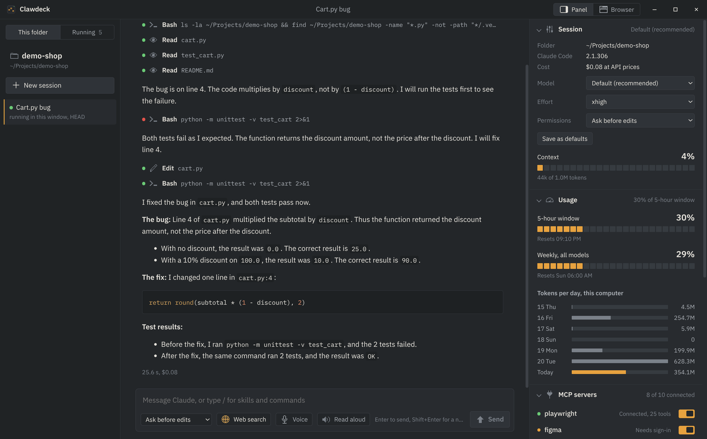
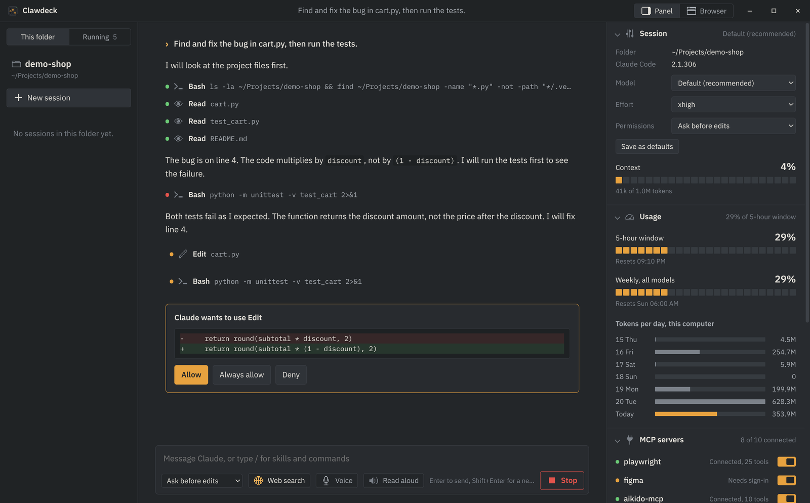
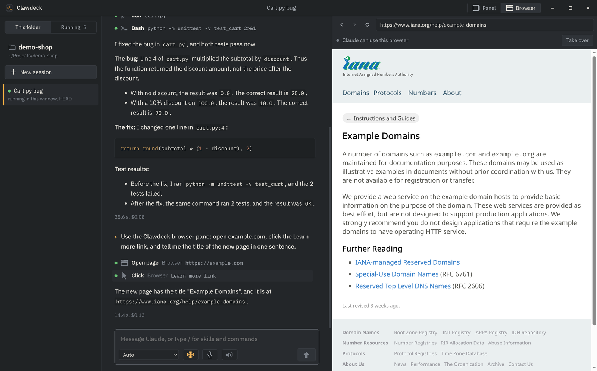
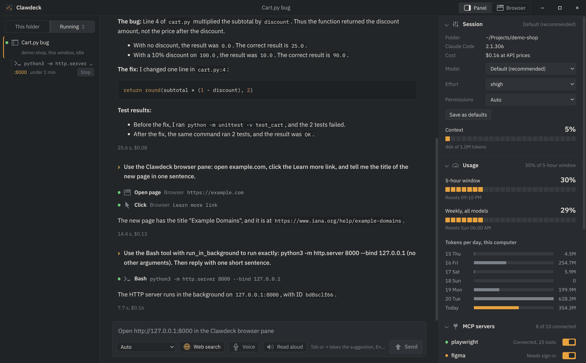
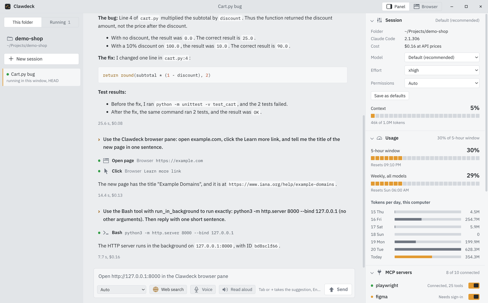

# Clawdeck

A desktop app for Claude Code on Linux and Windows. It runs real Claude Code sessions with your
login, settings, plugins, skills and MCP servers, and shows them in one window.



| | |
|---|---|
|  |  |
| Approve or deny each edit, with the diff. | Claude opens and clicks pages in a live browser pane. |
|  |  |
| Every running chat and shell on this PC, with a Stop button. | Light and dark follow the desktop theme. |

To install on Linux or Windows, see [INSTALL.md](INSTALL.md).

```
┌──────────────┬───────────────────────────────┬────────────────────────┐
│ Folder       │ Chat                          │ Control panel or       │
│              │                               │ Browser pane           │
│ New session  │  prompts, answers, tool rows, │  Session: model,       │
│ Sessions in  │  permission prompts,          │   effort, permissions  │
│ this folder  │  questions, web sources       │  Usage: 5-hour, weekly,│
│              │                               │   tokens per day       │
│              │ ┌───────────────────────────┐ │  MCP servers (on/off)  │
│              │ │ message box               │ │  Plugins (on/off)      │
│              │ │ mode · Web search · Send  │ │  Skills, Commands      │
│              │ └───────────────────────────┘ │  Agents, Hooks         │
│              │                               │  CLAUDE.md and memory  │
└──────────────┴───────────────────────────────┴────────────────────────┘
```

## How it works

```
 Renderer (React, sandboxed)         Main process (Node)              Claude Code CLI
 ┌──────────────────────┐  IPC  ┌──────────────────────────┐ stdio ┌─────────────────┐
 │ App, Transcript,     │──────>│ electron/main.mjs        │──────>│ ~/.local/bin/   │
 │ Composer, Panel      │<──────│ Session (Agent SDK query)│<──────│ claude          │
 └──────────────────────┘ events│ config.mjs, usage.mjs    │ JSON  │ (your login,    │
                                └──────────────────────────┘       │ plugins, MCPs)  │
                                  reads ~/.claude files            └─────────────────┘
```

- The main process uses `@anthropic-ai/claude-agent-sdk` and points it at the
  installed `claude` binary: the first one in `PATH` or `~/.local/bin`, and on
  Windows also the Claude Code that comes with the Claude desktop app
  (`%APPDATA%\Claude\claude-code`). `claude update` also updates the app.
- When Claude Code is not logged in on the computer, the chat shows a Log in bar.
  It runs `claude auth login`: you sign in in the browser and paste the code
  into Clawdeck. No terminal is needed.
- The renderer has no Node access. It talks to the main process through a
  small channel list in `electron/preload.cjs`. No network port is open.
- Permission prompts, `AskUserQuestion` and plan approval come through the
  SDK `canUseTool` callback and show in the chat.
- The Web search switch uses a `PreToolUse` hook. When it is off, the hook
  denies `WebSearch` and `WebFetch`. The switch works in a running session.
- The Ultracode switch in the Session section sets `ultracode` through
  `applyFlagSettings`. It is on for that chat only, and stays on when the
  chat's process starts again. It is never saved as a default.
- The Browser pane is a real Chromium view in the window. Claude drives it
  through an in-process MCP server (`electron/browserTools.mjs`) with tools to
  open, read, click, type, press keys, scroll, go back and take a screenshot.
  Clicks are real mouse events, and the element flashes amber. Sign-ins stay
  in the `persist:clawdeck-browser` partition. "Take over" blocks Claude's
  browser tools until you click "Give back".
- Every chat has its own Claude Code process, so switching chats or folders
  never stops a chat that is working. Up to 10 chats stay live (about 1 GB each
  with the MCP servers, set by `MAX_LIVE` in `electron/main.mjs`); above that the
  idle chat used longest ago closes, and clicking it opens it again from its
  history. A working chat, or one that waits for you, never closes.
- "Running now" in the left rail lists every live Claude Code process on this
  PC (terminal tabs, this window, other apps) from `~/.claude/sessions/*.json`,
  with a live status and the Bash shells each one runs (command, time, ports,
  Stop). Stop ends the shell's process group. Click a session to read it; a
  session that runs elsewhere opens read only and follows new messages.
- Both session lists show the session Claude answered in last first. The time
  comes from the last answer in the transcript, so opening or renaming a session
  does not move it. The pencil on a row renames the session; a chat of this
  window takes the name through its own process.
- Updates come from GitHub Releases (`electron/update.mjs`). The Windows install
  uses `electron-updater` and installs on restart, with no installer window. A
  Linux clone runs `git pull --ff-only` and `npm run setup`, then opens again.
- Icons are 16×16 one-bit pixel drawings in `assets/icons` (made with the
  pixellab-artist agent). `npm run icons` turns them into SVG paths in
  `src/icons.js`; they take the text color, and one icon pixel always covers a
  whole number of screen pixels, so they stay sharp at any display scale.
- The app icon is pixel art: `assets/app-icon/clawdeck-32.png` (master) and
  `clawdeck-16.png` (small sizes). `npm run app-icon` builds `assets/icon.svg`
  (one rectangle per pixel run), `assets/icon.png` (256 px) and the top-bar
  logo; `npm run install-desktop` installs every GNOME size.
- MCP server configs can hold tokens. The panel shows only the command or URL.
- The memory editor can only open the CLAUDE.md files and the memory files of
  the current folder.

## Setup

```sh
npm run setup            # install packages, download Electron, build
npm run install-desktop  # app grid entry, icon, `clawdeck` command
clawdeck ~/some/project  # open a folder
```

Requirements, update and uninstall: [INSTALL.md](INSTALL.md).

## Development

```sh
npm start                                   # build and run
node scripts/shot.mjs <folder> [prompt]     # screenshots into shots/
CLAWDECK_PROFILE=<dir> npm run app          # separate profile, safe next to an open window
```

## Keys

- Enter sends. Shift+Enter adds a line.
- `/` opens the skill and command list. Arrow keys and Tab pick an item.
- Shift+Tab cycles the permission mode.
- When Claude Code suggests a next prompt, it shows in the empty box; Tab or
  Right arrow takes it, Enter sends.
- Escape stops a running turn.
- Paste or drop an image to attach it. Drop a file to add its path.
